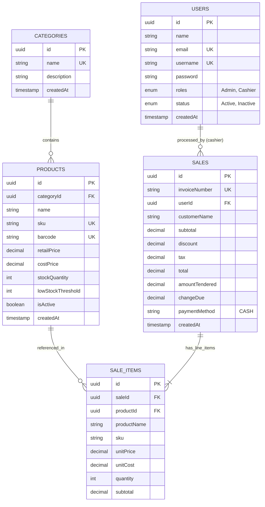

# Retail Point of Sale (POS) System with Cash Engine & AI Insights

> **Assessment Submission:** NT Tech Innovation — Full Stack Developer Practical Assessment
>
> **Submission Deadline:** 19 October 2026
>
> **Local URLs:** `http://localhost:3001` (Frontend) | `http://localhost:3900` (Backend API)
>
> **Swagger API Docs:** `http://localhost:3900/api/docs`

---

## 1. Project Overview & Business Problem

In fast-paced retail environments (supermarkets, apparel stores, corner retail shops), cash transactions and stock mismanagement often lead to discrepancies, slow checkout lines, and unexpected stockouts.

This full-stack Point of Sale (POS) application supports cash checkout, inventory control, and AI sales commentary for a local retail demo:

- **Instant Cash Checkout:** Validates tendered amount, auto-calculates change due, and records immutable sales records.
- **Atomic Stock Control:** Concurrency-safe, transactional decrement prevents overselling even with multiple active cashier terminals.
- **AI-Powered Store Copilot:** Utilizes the Google Gemini AI model to analyze sales velocity and stock levels, providing automated restock advisories and executive summaries.
- **Role-Based Access Control (RBAC):** Strict segregation between Store Admins (catalog & analytics) and Terminal Cashiers (checkout & receipts).

---

## 2. Technology Stack

| Layer | Technologies Used | Rationale |
| :--- | :--- | :--- |
| **Backend** | NestJS, TypeScript, Node.js | Enterprise-grade modular architecture with dependency injection and strong typing. |
| **ORM & Database** | TypeORM, PostgreSQL 17 | Type-safe entity modeling, automatic schema synchronization, transactional isolation. |
| **Authentication** | Passport.js, JWT, Bcrypt | Stateless JWT authentication, role guards (`Admin`, `Cashier`), bcrypt password hashing. |
| **API Documentation** | Swagger / OpenAPI (`/api/docs`) | Interactive API exploration and testing. |
| **Frontend** | Next.js (App Router), React, TypeScript | Fast server-side rendering and client-side terminal reactivity. |
| **Styling & UI** | Tailwind CSS, Lucide Icons | Clean, responsive POS terminal layout with zero runtime CSS overhead. |
| **Form & State** | Zod, React Query (TanStack Query) | Strict input validation, optimistic UI updates, and cached API requests. |
| **AI Integration** | Google Gemini API | Validated sales commentary using the official `@google/genai` SDK and stock-threshold recommendations. |
| **Containerization** | Docker, Docker Compose | Development services with persistent PostgreSQL storage. |

---

## 3. System Architecture & Database Schema

### Entity Relationship Model



---

## 4. Module Documentation

- [User & Authentication](doc/USER_MODULE.md)
- [Categories](doc/CATEGORY_MODULE.md)
- [Products & Inventory](doc/PRODUCT_MODULE.md)
- [Sales & Cash Checkout](doc/SALE_MODULE.md)
- [AI Sales Insights](doc/AI_MODULE.md)

## 5. Demo Login Credentials

Run the seed command in the setup guide to create these accounts. Use either the username or email in the login form.

| Role | Username | Email | Password |
| :--- | :--- | :--- | :--- |
| Store Admin | `admin` | `admin@pos.local` | `Admin@1234` |
| Terminal Cashier | `cashier` | `cashier@pos.local` | `Cashier@1234` |

The seed also creates 5 categories and 10 products, including low-stock milk and eggs for demonstrating inventory alerts. It skips existing users and products, so rerunning it does not reset changed passwords or replenish stock. The values above are the defaults; `ADMIN_*` and `CASHIER_*` environment variables can override them before seeding.

These accounts are for the local assessment/demo. pgAdmin has a separate login: `gowtampaul0@gmail.com` / `pos@`, as configured in [docker-compose.dev.yml](docker-compose.dev.yml).

## 6. Setup Instructions

### Prerequisites

- Clone this repository and open a terminal in its root directory.
- Install Docker with Docker Compose v2 for the container setup.
- For running the applications on your host, also install Node.js 24 and npm.
- Keep ports `3001`, `3900`, and `5543` available; pgAdmin uses `5050`.

### Create the environment files

Both setup methods use these files. Copy the committed examples on a fresh clone:

```bash
cp -n server/.env.example server/.env.development
cp -n client/.env.example client/.env.local
```

`cp -n` preserves an existing configuration. The backend loads `.env.development.local`, `.env.development`, and `.env` in that order; process environment variables take precedence. Next.js loads `client/.env.local`. Restart the relevant application after changing its environment.

**Backend example — `server/.env.development`:**

```env
NODE_ENV=development

# Server API
API_PORT=3900
FRONTEND_URL=http://localhost:3001

# JWT Authentication
JWT_SECRET_KEY=pos_jwt_secret_super_secure_key_2026
JWT_EXPIRES=7d

# Database (PostgreSQL)
# - If running server inside Docker: DB_HOST=postgres, DB_PORT=5432
# - If running server directly on machine: DB_HOST=localhost, DB_PORT=5543
DB_HOST=localhost
DB_PORT=5543
DB_USERNAME=pos
DB_PASSWORD=pos@
DB_DATABASE=pos
DB_SYNCHRONIZE=true
DB_MIGRATIONS_RUN=false
ENABLE_ORM_LOGS=false

# Optional AI Module (Google Gemini API for Sales Insights)
GEMINI_API_KEY=your_gemini_api_key_here
GEMINI_MODEL=gemini-2.5-flash
GEMINI_TIMEOUT_MS=15000
# Calendar day boundaries for sales reports; use the store's IANA timezone.
STORE_TIMEZONE=Asia/Dhaka
```

**Frontend example — `client/.env.local`:**

```env
# API URL used by the browser when opening localhost:3001.
NEXT_PUBLIC_API_URL=http://localhost:3900/api/v1

# Full Next.js rewrite destination for /api/v1/:path*.
# Docker Compose overrides localhost with the backend service name.
INTERNAL_API_URL=http://localhost:3900/api/v1/:path*
```

| Variable | Purpose |
| :--- | :--- |
| `API_PORT` | Backend listening port, default demo value `3900`. |
| `FRONTEND_URL` | Frontend origin, `http://localhost:3001`. |
| `JWT_SECRET_KEY`, `JWT_EXPIRES` | JWT signing secret and token lifetime. The example key is a development value. |
| `DB_HOST`, `DB_PORT`, `DB_USERNAME`, `DB_PASSWORD`, `DB_DATABASE` | PostgreSQL connection. Host applications use `localhost:5543`; Docker backend uses `postgres:5432`. |
| `DB_SYNCHRONIZE` | `true` creates/updates the local demo schema from TypeORM entities. |
| `DB_MIGRATIONS_RUN` | `false` keeps automatic migration execution disabled for this demo setup. |
| `ENABLE_ORM_LOGS` | Enables database query logging when `true`. |
| `NEXT_PUBLIC_API_URL` | Browser API base URL, including `/api/v1`. |
| `INTERNAL_API_URL` | Full Next.js rewrite destination, including `/:path*`, as used by the current Next.js configuration. |
| `GEMINI_API_KEY` | Optional Google AI Studio API key. Leave the placeholder to use the heuristic fallback. |
| `GEMINI_MODEL` | Gemini model name, default `gemini-2.5-flash`. |
| `GEMINI_TIMEOUT_MS` | Gemini request timeout, default `15000` milliseconds. |
| `STORE_TIMEZONE` | IANA timezone for AI report calendar-day boundaries, e.g. `Asia/Dhaka`. |

### Method A: Docker Compose

From the repository root, after creating the environment files:

```bash
docker compose -f docker-compose.dev.yml up -d --build
```

Compose overrides the backend database connection to `postgres:5432` and the frontend rewrite destination to `http://server:3900/api/v1/:path*`. PostgreSQL has a health check; the backend starts after it is ready.

Wait until the backend reports that it is listening on port `3900`:

```bash
docker compose -f docker-compose.dev.yml logs -f server
```

Press Ctrl+C to leave the log view; the services stay running. Then seed the demo:

```bash
docker compose -f docker-compose.dev.yml exec server npm run seed
```

Open [http://localhost:3001/login](http://localhost:3001/login) and sign in with a demo account. Other local URLs:

| Service | URL / Connection |
| :--- | :--- |
| Frontend | [http://localhost:3001](http://localhost:3001) |
| Swagger API documentation | [http://localhost:3900/api/docs](http://localhost:3900/api/docs) |
| API base | `http://localhost:3900/api/v1` |
| PostgreSQL from your host | `localhost:5543`, database `pos`, username `pos`, password `pos@` |
| pgAdmin | [http://localhost:5050](http://localhost:5050) |

To stop the development services while keeping database data:

```bash
docker compose -f docker-compose.dev.yml down
```

### Method B: Host Node.js applications with Docker PostgreSQL

Create the environment files above. Keep `DB_HOST=localhost`, `DB_PORT=5543`, and the frontend example URLs. From the repository root:

```bash
docker compose -f docker-compose.dev.yml up -d postgres
docker compose -f docker-compose.dev.yml exec postgres pg_isready -U pos -d pos
```

Proceed when PostgreSQL reports that it is accepting connections.

**Terminal 1 — backend:**

```bash
cd server
npm ci
npm run seed
npm run start:dev
```

The seed creates the local schema and demo data through the application's TypeORM configuration.

**Terminal 2 — frontend, starting from the repository root:**

```bash
cd client
npm ci
npm run dev
```

Open [http://localhost:3001/login](http://localhost:3001/login). If using your own PostgreSQL instance instead, create the database and user first and update the backend `DB_*` values to match.

### Setup Troubleshooting

- **Missing environment file:** create both files from the committed examples before starting Compose.
- **Cannot connect to PostgreSQL:** check `pg_isready`, database credentials, and host/port. Compose sets container database values; host Node.js applications use `localhost:5543`.
- **Port already in use:** stop the conflicting service or adjust the port mappings and corresponding environment URLs.
- **`Cannot find module '@google/genai'` inside Docker:** container dependencies use a separate volume. Install updated dependencies there and restart the backend:

  ```bash
  docker compose -f docker-compose.dev.yml exec server npm ci
  docker compose -f docker-compose.dev.yml restart server
  ```

- **Invalid demo login:** run the seed command and confirm the account was created. Existing accounts retain their current password; environment overrides can also change the initial credentials.
- **Gemini unavailable:** the report uses the heuristic engine when the key is missing, a request fails, or the response is invalid. Check the returned `engine` field.
- **Receipt printing:** use the browser's print dialog, select a printer or Save as PDF, and choose your printer's 80mm paper setting when using a thermal printer.

---

## 7. Key API Endpoints

All endpoints are prefixed with `/api/v1`. Live interactive testing is available at `http://localhost:3900/api/docs`.

### Authentication (`/auth`)

| Method | Endpoint | Access | Description |
| :--- | :--- | :--- | :--- |
| `POST` | `/api/v1/auth/login` | Public | Authenticates credentials and issues JWT token in response & HTTP cookie. |
| `POST` | `/api/v1/auth/register` | Public | Registers a new Cashier user account. |
| `GET` | `/api/v1/auth/me` | Authenticated | Retrieves current authenticated session and profile details. |
| `POST` | `/api/v1/auth/refresh` | Authenticated | Refreshes active JWT session token. |
| `DELETE` | `/api/v1/auth/logout` | Authenticated | Clears authorization cookies and session. |

### Users (`/users`)

| Method | Endpoint | Access | Description |
| :--- | :--- | :--- | :--- |
| `GET` | `/api/v1/users` | Admin | Paginated list of users with search and filter capabilities. |
| `POST` | `/api/v1/users` | Admin | Manually creates a user with designated role (`Admin` or `Cashier`). |
| `PUT` | `/api/v1/users/:id` | Admin | Updates user name, status, or role. |
| `PATCH` | `/api/v1/users/update-password/:id` | Admin | Resets a user password securely. |
| `DELETE` | `/api/v1/users/:id` | Admin | Removes user record from database. |

### Products & Inventory (`/products`)

| Method | Endpoint | Access | Description |
| :--- | :--- | :--- | :--- |
| `GET` | `/api/v1/products` | Cashier / Admin | Searches products by title, category, or barcode. |
| `GET` | `/api/v1/products/barcode/:barcode` | Cashier / Admin | Instant product lookup for USB/Bluetooth barcode scanner. |
| `POST` | `/api/v1/products` | Admin | Adds a new product with retail price, cost price, and initial stock. |
| `PUT` | `/api/v1/products/:id` | Admin | Updates pricing, stock quantity, or low-stock thresholds. |

### Sales & Cash Checkout (`/sales`)

| Method | Endpoint | Access | Description |
| :--- | :--- | :--- | :--- |
| `POST` | `/api/v1/sales/checkout` | Cashier / Admin | **Atomic Transaction:** Validates cash tendered $\ge$ total, calculates change due, decrements inventory stock, and logs immutable sale. |
| `GET` | `/api/v1/sales` | Cashier / Admin | Lists transaction history. |
| `GET` | `/api/v1/sales/:id` | Cashier / Admin | Retrieves itemized receipt breakdown for a specific sale. |

### AI Store Copilot (`/ai`)

| Method | Endpoint | Access | Description |
| :--- | :--- | :--- | :--- |
| `POST` | `/api/v1/ai/sales-insights?days=1` | Cashier / Admin | Generates calendar-day sales commentary and low-stock recommendations; `days` accepts 1–30. |

### Module Deep-Dive Documentation

- 📘 [User & Auth Module Documentation](doc/USER_MODULE.md) — Authentication flow, password policies, and user CRUD.
- 📁 [Category Module Documentation](doc/CATEGORY_MODULE.md) — Categories, auto-slugification, and RBAC.
- 📦 [Product Module Documentation](doc/PRODUCT_MODULE.md) — Product architecture, barcode scanning, low-stock alerts, and stock adjustments.
- 💳 [Sale & Cash Checkout Module Documentation](doc/SALE_MODULE.md) — Checkout transactions, change calculation, and line-item snapshots.

---

## 8. AI Feature Details

The service uses the official Google Gen AI SDK (`@google/genai`) with `gemini-2.5-flash` by default. Configure an optional key from [Google AI Studio](https://aistudio.google.com/) in `GEMINI_API_KEY` and restart the backend.

- **Inputs:** completed-sale totals, the five highest-volume items, active inventory, and low-stock thresholds.
- **Period:** 1–30 calendar days including today in `STORE_TIMEZONE`; `days=1` starts at today's midnight. This is not a cashier shift calculation.
- **Outputs:** executive summary, stock urgency, reorder quantities, top performers, and practical recommendations. The API returns JSON displayed by the AI Copilot modal.
- **Data integrity:** Gemini supplies commentary. Sales totals, item quantities, stock levels, urgency, and reorder quantities are calculated by the server. AI output is schema-constrained and validated at runtime.
- **Fallback:** requests have a default 15-second timeout with retries disabled. Missing keys, SDK failures, timeouts, and invalid responses return a complete heuristic report. Database failures still surface as API errors.
- **Limitation:** reorder quantities use stock thresholds, not a trained demand forecast. Generated commentary can be imperfect; the SDK tests use mocked responses rather than live Google API calls.

---

## 9. Technical Decisions & Live Review Defense

When reviewing the code or performing live modifications during technical review:

### 1. Concurrency Control on Inventory (Pessimistic Row Locking)

- **Problem:** Two cashiers scanning the last item simultaneously could result in negative stock.
- **Solution:** We use database-level pessimistic locking (`SELECT ... FOR UPDATE`) inside an isolated TypeORM transaction:
  ```ts
  const product = await manager
    .createQueryBuilder(ProductEntity, 'product')
    .setLock('pessimistic_write')
    .where('product.id = :id', { id: productId })
    .getOne();
  ```
  If available stock is lower than requested quantity, the transaction immediately rolls back with an informative `400 Bad Request` before altering any state.

### 2. Financial Ledger Immutability

- Line items are stored as independent static snapshots in `sale_items` at the moment of sale (`unit_price`, `unit_cost`, `product_name`, `product_sku`).
- Future edits to product names or catalog prices will never corrupt historical receipts or accounting totals.

---

## 10. Validation

Run backend unit tests, including the AI service and controller regression tests:

```bash
cd server
npm test -- --runInBand
```

Check TypeScript without emitting build files in each application directory:

```bash
# From server/
npx tsc --noEmit --incremental false
```

```bash
# From client/
npx tsc --noEmit --incremental false
```

The AI tests cover invalid responses, missing keys, SDK errors, preserving stock alerts, and report/controller behavior. Full checkout and printing should also be exercised using the walkthrough below.

## 11. Demo Walkthrough

1. Seed the data and log in as `admin` or `cashier`.
2. Search for a product, or enter barcode `890103000001` and press Enter to add Coca-Cola to the cart.
3. Adjust quantities and review subtotal, discount, tax, and total.
4. Complete cash checkout with an amount greater than or equal to the total; verify the returned change.
5. Click **Print Receipt** and inspect the browser print preview or save a PDF.
6. Open **AI Copilot** to see sales commentary and the low-stock milk/egg recommendations. Without a Gemini key, confirm the heuristic engine label.
7. Toggle light/dark mode and confirm the terminal and receipt controls stay readable.
