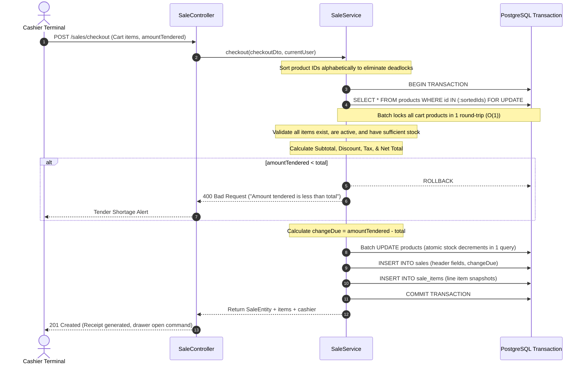

# Sale & Cash Checkout Module Documentation

> **System:** Retail Point of Sale (POS) Backend  
> **Module Path:** `server/src/modules/sale`  
> **Database Tables:** `sales`, `sale_items` (PostgreSQL)  
> **API Base Prefix:** `/api/v1`  
> **Interactive Swagger Docs:** `http://localhost:3900/api/docs`

---

## 1. Overview & Business Problem

In high-traffic retail environments, the **Checkout Engine** is the most critical component. It handles financial transactions, prevents double-selling through concurrency control, and guarantees accounting auditability.

### Core Problems Solved:
1. **Cash Over/Short Discrepancies:**
   - Validates that cash tendered by the customer meets or exceeds the payable total (`amountTendered >= total`).
   - Auto-computes precise change due (`changeDue = amountTendered - total`).
2. **Double-Selling & Race Conditions:**
   - When multiple cashier terminals scan items simultaneously, database-level pessimistic locking (`SELECT ... FOR UPDATE`) prevents overselling.
   - Guaranteed atomic decrements within an isolated TypeORM database transaction.
3. **Receipt & Ledger Immutability:**
   - Product catalog prices and names may change in the future.
   - Every line item is saved as a frozen snapshot in `sale_items` with the exact `productName`, `productSku`, `unitPrice`, and `unitCost` at the moment of sale.
4. **Fast Financial Reconciliation:**
   - Instant daily summary endpoint (`GET /sales/summary/today`) delivers total revenue, transaction counts, items sold, total cash collected, and change disbursed for cash drawer balancing.

---

## 2. File & Directory Structure

```
server/src/modules/sale/
├── controllers/
│   └── sale.controller.ts          # REST endpoints with Swagger OpenAPI documentation
├── dtos/
│   ├── checkout-sale.dto.ts        # Cart items and cash tender validation schema
│   ├── filter-sale.dto.ts          # Sales history filters (date range, cashier, search)
│   └── index.ts                    # DTO export barrel
├── entities/
│   ├── sale.entity.ts              # Financial header entity ('sales' table)
│   └── sale-item.entity.ts         # Line-item snapshot entity ('sale_items' table)
├── services/
│   └── sale.service.ts             # Transactional checkout, locking, and daily reporting
└── sale.module.ts                  # NestJS module registering TypeORM entities & providers
```

---

## 3. Database Schema

### 3.1 `sales` Table (Transaction Header)

| Column | Type | Constraints | Description |
| :--- | :--- | :--- | :--- |
| `id` | `UUID` | `PRIMARY KEY` | Unique sale identifier. |
| `invoice_number` | `VARCHAR` | `NOT NULL, UNIQUE` | Customer receipt invoice number (e.g., `INV-20261017-9573`). |
| `user_id` | `UUID` | `NOT NULL, FK -> users(id)` | Cashier who processed the transaction. |
| `customer_name` | `VARCHAR` | `DEFAULT 'Walk-in Customer'` | Customer name. |
| `customer_phone` | `VARCHAR` | `NULLABLE` | Customer phone for digital receipts/SMS. |
| `subtotal` | `NUMERIC(12,2)` | `NOT NULL, DEFAULT 0.00` | Sum of all line item subtotals. |
| `tax` | `NUMERIC(12,2)` | `NOT NULL, DEFAULT 0.00` | Calculated tax amount. |
| `tax_rate` | `NUMERIC(5,2)` | `NOT NULL, DEFAULT 0.00` | Tax percentage applied (e.g. `5.00` for 5%). |
| `discount` | `NUMERIC(12,2)` | `NOT NULL, DEFAULT 0.00` | Discount deducted from subtotal. |
| `total` | `NUMERIC(12,2)` | `NOT NULL, DEFAULT 0.00` | Net payable total: `(subtotal - discount) + tax`. |
| `amount_tendered`| `NUMERIC(12,2)` | `NOT NULL, DEFAULT 0.00` | Total physical cash handed over by customer. |
| `change_due` | `NUMERIC(12,2)` | `NOT NULL, DEFAULT 0.00` | Physical cash returned: `amount_tendered - total`. |
| `payment_method` | `VARCHAR` | `DEFAULT 'CASH'` | Tender method (`CASH`). |
| `status` | `ENUM` | `DEFAULT 'COMPLETED'` | `COMPLETED`, `REFUNDED`, `VOIDED`. |
| `notes` | `TEXT` | `NULLABLE` | Optional transaction remarks. |
| `createdAt` | `TIMESTAMPTZ` | `DEFAULT NOW()` | Timestamp of transaction. |
| `updatedAt` | `TIMESTAMPTZ` | `DEFAULT NOW()` | Timestamp of modification. |

### 3.2 `sale_items` Table (Line-Item Snapshot)

| Column | Type | Constraints | Description |
| :--- | :--- | :--- | :--- |
| `id` | `UUID` | `PRIMARY KEY` | Unique line-item ID. |
| `sale_id` | `UUID` | `NOT NULL, FK -> sales(id) ON DELETE CASCADE` | Parent sale record. |
| `product_id` | `UUID` | `NULLABLE, FK -> products(id) ON DELETE SET NULL` | Reference to original catalog product. |
| `product_name` | `VARCHAR` | `NOT NULL` | Frozen product name snapshot. |
| `product_sku` | `VARCHAR` | `NOT NULL` | Frozen SKU snapshot. |
| `unit_price` | `NUMERIC(12,2)` | `NOT NULL` | Selling price per unit at sale time. |
| `unit_cost` | `NUMERIC(12,2)` | `NOT NULL, DEFAULT 0.00` | Purchase cost per unit at sale time. |
| `quantity` | `INT` | `NOT NULL, DEFAULT 1` | Units sold. |
| `subtotal` | `NUMERIC(12,2)` | `NOT NULL` | Line total (`quantity * unit_price`). |
| `createdAt` | `TIMESTAMPTZ` | `DEFAULT NOW()` | Line creation timestamp. |

---

## 4. Role-Based Access Control (RBAC) Matrix

| Endpoint | Method | Route | Admin Access | Cashier Access | Description |
| :--- | :---: | :--- | :---: | :---: | :--- |
| **Checkout Sale** | `POST` | `/api/v1/sales/checkout` | ✅ Allowed | ✅ Allowed | Processes cash transaction & decrements stock. |
| **List Sales History**| `GET` | `/api/v1/sales` | ✅ Allowed | ✅ Allowed | Paginated transactions with date/cashier filters. |
| **Today's Summary** | `GET` | `/api/v1/sales/summary/today` | ✅ Allowed | ✅ Allowed | Daily drawer balance and revenue totals. |
| **Invoice Lookup** | `GET` | `/api/v1/sales/invoice/:num` | ✅ Allowed | ✅ Allowed | Instant receipt retrieval by invoice number. |
| **Get Sale by ID** | `GET` | `/api/v1/sales/:id` | ✅ Allowed | ✅ Allowed | Detailed transaction breakdown. |

---

## 5. Optimized Checkout Transaction Lifecycle



---

## 6. REST API Endpoints Specification

### 6.1 Process Cash Checkout
- **Method / Path:** `POST /api/v1/sales/checkout`
- **Headers:** `Authorization: Bearer <TOKEN>`
- **Request Body:**
```json
{
  "items": [
    {
      "productId": "7895ae43-2921-4afa-bc0c-ea214852e8b7",
      "quantity": 2
    }
  ],
  "amountTendered": 100.00,
  "discount": 5.00,
  "taxRate": 5.00,
  "customerName": "Alice Johnson",
  "customerPhone": "+1-555-0199",
  "notes": "Counter 1 Morning Shift"
}
```
- **Response (201 Created):**
```json
{
  "success": true,
  "statusCode": 201,
  "message": "Transaction completed successfully",
  "data": {
    "id": "e8d6411f-50d4-47ba-89a1-77893a906cc8",
    "invoiceNumber": "INV-20261017-9573",
    "userId": "3e1970c7-a1e6-43a8-b20f-256396ffdd4e",
    "customerName": "Alice Johnson",
    "customerPhone": "+1-555-0199",
    "subtotal": 90.00,
    "discount": 5.00,
    "taxRate": 5.00,
    "tax": 4.25,
    "total": 89.25,
    "amountTendered": 100.00,
    "changeDue": 10.75,
    "paymentMethod": "CASH",
    "status": "COMPLETED",
    "items": [
      {
        "id": "a1b2c3d4-0000-0000-0000-000000000001",
        "productName": "Coca-Cola 500ml Can",
        "productSku": "BEV-COCA-500",
        "unitPrice": 45.00,
        "quantity": 2,
        "subtotal": 90.00
      }
    ],
    "createdAt": "2026-10-17T13:43:15.000Z"
  }
}
```

### 6.2 Today's Financial Summary
- **Method / Path:** `GET /api/v1/sales/summary/today`
- **Response (200 OK):**
```json
{
  "success": true,
  "statusCode": 200,
  "message": "Today's sales summary retrieved",
  "data": {
    "date": "2026-10-17",
    "totalRevenue": 89.25,
    "totalTransactions": 1,
    "totalItemsSold": 2,
    "totalTax": 4.25,
    "totalDiscount": 5.00,
    "totalCashTendered": 100.00,
    "totalChangeGiven": 10.75
  }
}
```

---

## 7. Automated Test Verification Results

All 12 test cases executed end-to-end against PostgreSQL with 100% success:

| Test Case | Method | Endpoint / Condition | HTTP Code | Status |
| :---: | :--- | :--- | :---: | :---: |
| 1 | `POST` | Cashier Authentication (`cashier@pos.local`) | `200` | ✅ PASSED |
| 2 | `POST` | Admin Authentication (`admin@pos.local`) | `200` | ✅ PASSED |
| 3 | `GET` | Product catalog inspection before sale | `200` | ✅ PASSED |
| 4 | `POST` | Empty Cart validation guard | `400` | ✅ PASSED |
| 5 | `POST` | Tendered cash less than total check | `400` | ✅ PASSED |
| 6 | `POST` | Stock quantity overflow check | `400` | ✅ PASSED |
| 7 | `POST` | Valid checkout with cash change calculation | `201` | ✅ PASSED |
| 8 | `GET` | Stock decremented by exact purchased quantity | `200` | ✅ PASSED |
| 9 | `GET` | Receipt lookup by invoice number | `200` | ✅ PASSED |
| 10 | `GET` | Receipt lookup by sale UUID | `200` | ✅ PASSED |
| 11 | `GET` | Today's drawer balance & revenue summary | `200` | ✅ PASSED |
| 12 | `GET` | Paginated sales transaction history | `200` | ✅ PASSED |

