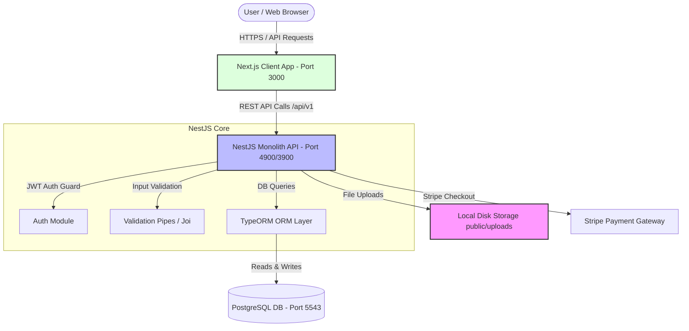
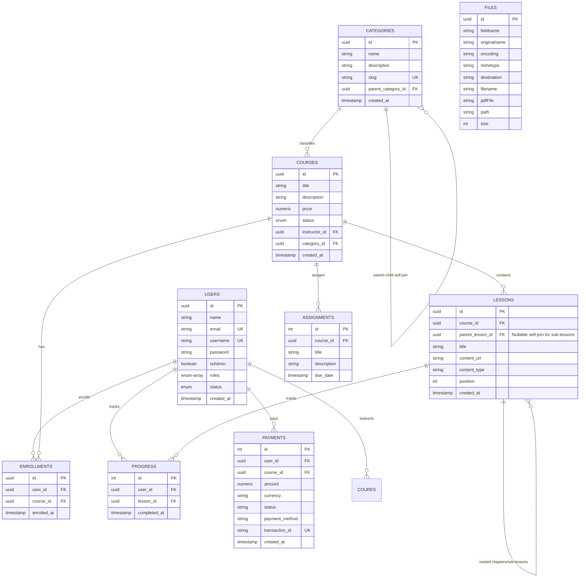
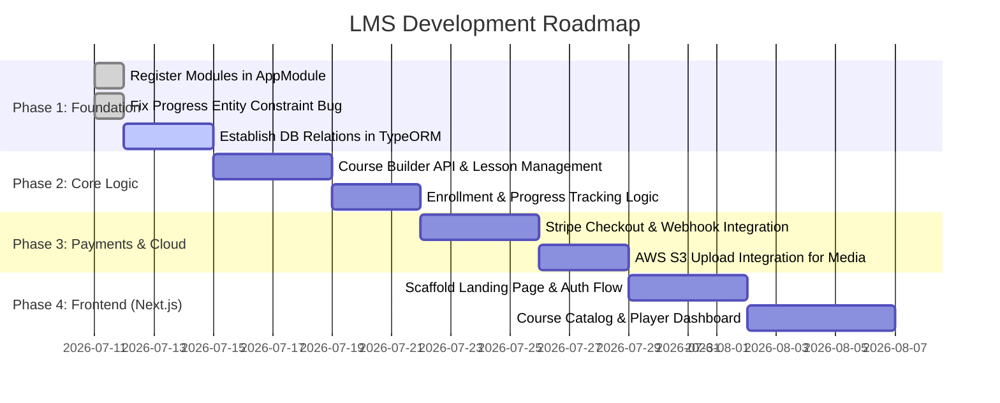

# System Design Analysis: Learning Management System (LMS)

This document provides a comprehensive analysis and system design for the LMS project based on the current Next.js client and NestJS server codebases. It highlights current implementation gaps and presents a target architecture, database model, API contract, and step-by-step roadmap to evolve the codebase into a production-ready application.

---

## 1. Executive Summary
The LMS is designed as a modular online education platform. It supports three distinct user roles:
- **Students**: Browse courses, purchase/enroll, consume lessons (videos, text), complete quizzes, and track progress.
- **Instructors**: Build courses, manage lesson curricula, upload media content, and monitor student enrollments.
- **Admins**: Manage users, review and approve courses, configure categories, and audit financial payments.

The project uses a modern JavaScript/TypeScript web stack:
- **Frontend**: Next.js 15 (App Router, React 19, Tailwind CSS v4).
- **Backend**: NestJS 11 (Modular REST API, Passport JWT Auth, TypeORM).
- **Database**: PostgreSQL 17 (Relational database with transactional support).
- **Media**: Local disk storage (development) transitioning to AWS S3/MinIO (production).

---

## 2. Codebase Analysis & Key Architectural Gaps

An analysis of the current `/client` and `/server` codebases reveals the following findings:

### 2.1 The "Unregistered Modules" Issue
While the NestJS codebase has skeleton directories under `server/src/modules/` for the core features, they are **not currently imported** into the main application module.
- `server/src/app.module.ts` only registers `AdminModule`, `DatabaseModule`, `FileModule`, and `CategoriesModule`.
- `AdminModule` registers `UserModule` and `AuthModule`.
- The following modules are **completely isolated** and their controllers/endpoints are inactive:
  - `CoursesModule` (defines courses metadata, prices, instructor links)
  - `LessonsModule` (handles video and text lessons)
  - `EnrollmentsModule` (manages student-course mapping)
  - `ProgressModule` (tracks completed lessons)
  - `AssignmentModule` (manages course assignments)
  - `PaymentsModule` (handles transaction records)

### 2.2 Boilerplate Service Implementations
Most of the isolated modules are simple CLI-generated placeholders:
- `CoursesService`, `LessonsService`, etc., contain hardcoded methods (e.g., `return 'This action adds a new course'`) and do not perform any database query or business logic operations.

### 2.3 Progress Entity Database Typos / Constraint Bugs
In `server/src/modules/progress/entities/progress.entity.ts`, the unique constraint is defined as:
```typescript
@Unique(['user', 'lesson'])
```
However, the entity properties are named `userId` and `lessonId`. Unless relations are explicitly declared under properties named `user` and `lesson`, TypeORM will fail to resolve this constraint, resulting in a database generation or migration error. This needs to be corrected to:
```typescript
@Unique(['userId', 'lessonId'])
```

### 2.4 Local Disk Upload vs. Cloud Object Storage
The `FileModule` (`server/src/modules/admin/file`) utilizes NestJS `FileInterceptor` with Multer's `diskStorage` to save files directly to local disk under `public/uploads`. While suitable for development, this will fail in multi-instance production environments (e.g. AWS ECS/Fargate, Kubernetes) because local uploads are not shared across server replicas.

---

## 3. System Architecture Diagram

Below is the request-response and data flow architecture:



### Future Production Scaling Architecture:
For high-traffic production, the components scale as follows:
```
[Next.js App] ---> [AWS Application Load Balancer]
                         |
           +-------------+-------------+
           v                           v
     [NestJS App Instance 1]     [NestJS App Instance 2]
           |                           |
           +------+-------------+------+
                  v             v
       [PostgreSQL RDS]   [AWS S3 / CloudFront]  <-- Direct Video & Asset Delivery
                  |             |
           [ElastiCache Redis]  <-- Caching & Bull MQ background transcoding jobs
```

---

## 4. Database Schema Design (ERD)

The relational database is built on top of PostgreSQL. The following Mermaid Entity Relationship Diagram details how these models relate to each other:



---

## 5. API Endpoint Specifications

The following table summarizes the endpoints that need implementation/registration to fulfill the LMS workflow:

| Domain | Method | Endpoint | Description | Guard |
| :--- | :--- | :--- | :--- | :--- |
| **Auth** | `POST` | `/api/v1/auth/register` | Register a new user (Student or Instructor) | Public |
| | `POST` | `/api/v1/auth/login` | Login and return JWT in cookie | Public |
| | `GET` | `/api/v1/auth/me` | Fetch currently logged-in user details | JWT |
| **Users** | `GET` | `/api/v1/users` | List users (with filtering) | JWT + Admin |
| | `DELETE` | `/api/v1/users/:id` | Soft delete or delete user | JWT + Admin |
| **Categories**| `GET` | `/api/v1/categories` | Get hierarchical category tree | Public |
| | `POST` | `/api/v1/categories` | Create course category | JWT + Admin |
| **Courses** | `GET` | `/api/v1/courses` | List published courses (Catalog page) | Public |
| | `POST` | `/api/v1/courses` | Create a new course draft | JWT + Instructor |
| | `PATCH` | `/api/v1/courses/:id` | Update course details / submit to review | JWT + Instructor |
| | `PUT` | `/api/v1/courses/:id/publish` | Approve and publish a course | JWT + Admin |
| **Lessons** | `POST` | `/api/v1/courses/:id/lessons` | Add a lesson / sub-lesson to a course | JWT + Instructor |
| | `GET` | `/api/v1/courses/:id/lessons` | Fetch lessons outline (enrolled/instructor only) | JWT |
| **Enroll** | `POST` | `/api/v1/courses/:id/enroll` | Direct enrollment for free courses | JWT |
| **Payments** | `POST` | `/api/v1/payments/checkout` | Create Stripe checkout session for paid course | JWT |
| | `POST` | `/api/v1/payments/webhook` | Stripe payment verification webhook | Public |
| **Progress** | `POST` | `/api/v1/lessons/:id/complete` | Mark lesson completed | JWT |
| | `GET` | `/api/v1/courses/:id/progress` | Fetch current student progress percentage | JWT |

---

## 6. Implementation & Integration Roadmap

To evolve this codebase from its current skeleton to a functional LMS MVP, follow this implementation roadmap:



### Detailed Execution Steps:

#### Step 1: Wire Up all Modules in `app.module.ts`
Import `CoursesModule`, `LessonsModule`, `EnrollmentsModule`, `ProgressModule`, `AssignmentModule`, and `PaymentsModule` into `app.module.ts` so NestJS handles dependency injection for these routes.

#### Step 2: Declare Database Entity Relations
In the TypeORM entities, declare proper decorator relationships (e.g., `@ManyToOne`, `@OneToMany`) for:
- `Course` ↔ `Category`
- `Lesson` ↔ `Course`
- `Lesson` ↔ `Lesson` (self-join for nested sub-lessons)
- `Enrollment` ↔ `UserEntity` & `Course`
- `Progress` ↔ `UserEntity` & `Lesson`

#### Step 3: Implement Progress Calculation Query
Add a repository query to count the total lessons of a course and the number of completed lessons for a user to calculate the percentage:
```typescript
const totalLessons = await this.lessonsRepository.count({ where: { courseId } });
const completedLessons = await this.progressRepository.count({ where: { userId, lessonId: In(lessonIds) } });
const progressPercent = totalLessons > 0 ? (completedLessons / totalLessons) * 100 : 0;
```

#### Step 4: Stripe Integration
1. Set up a checkout endpoint that creates a Stripe session.
2. Build a webhook listener endpoint (`/api/v1/payments/webhook`) using raw body parsing to verify the signature.
3. Upon receiving `checkout.session.completed`, set payment status to `completed` and write a record to the `enrollments` table.

#### Step 5: Next.js Frontend Scaffolding
Utilize Tailwind CSS v4 to style modern pages:
- `/` - A premium, dark-mode design layout showing featured categories and courses.
- `/login` - Interactive login page with client-side cookies storage.
- `/courses` - Searchable catalog.
- `/courses/[id]` - Learning dashboard/player page containing a sidebar curriculum outline and a primary video/text player.
